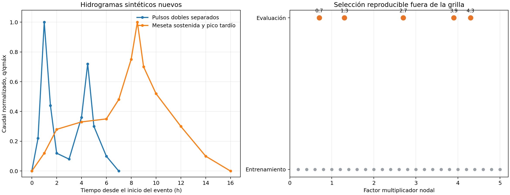
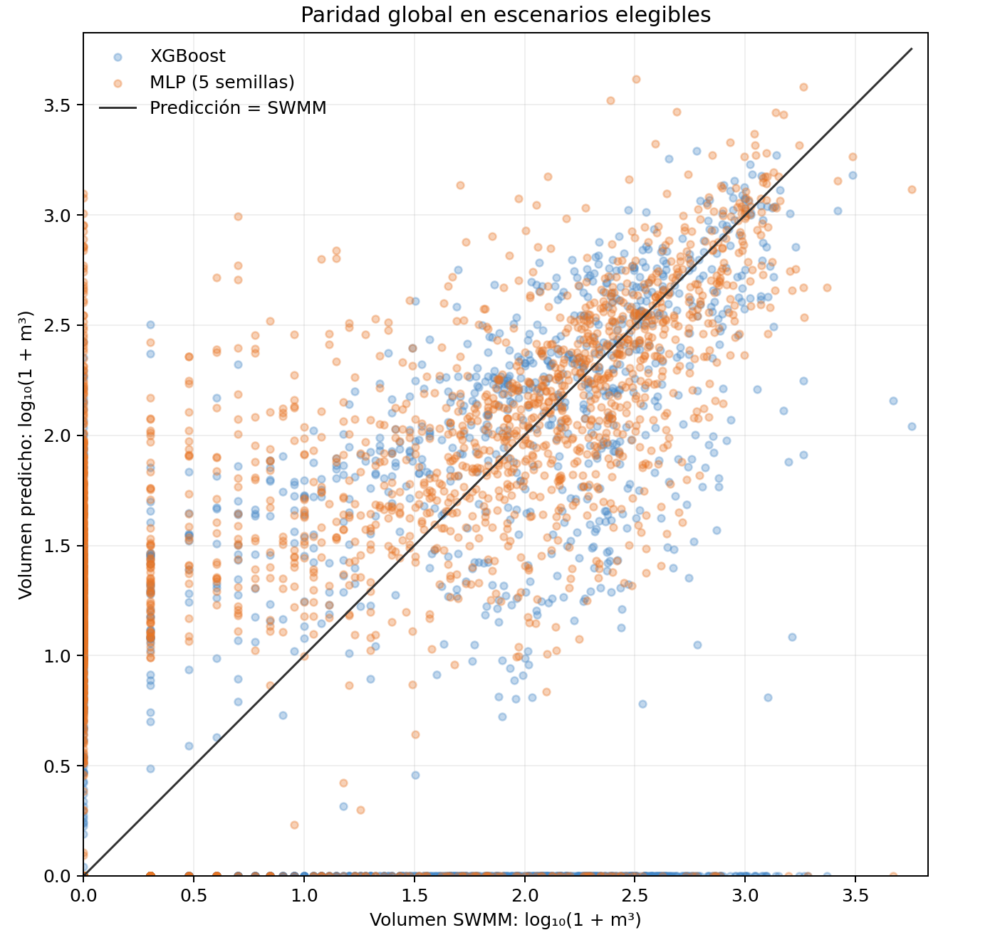
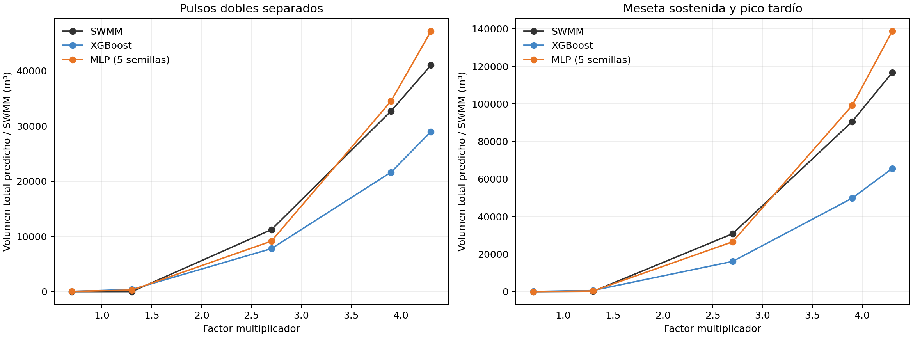
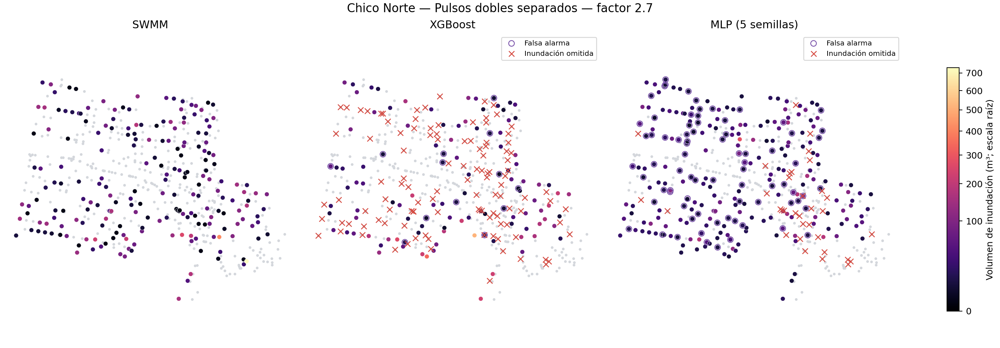
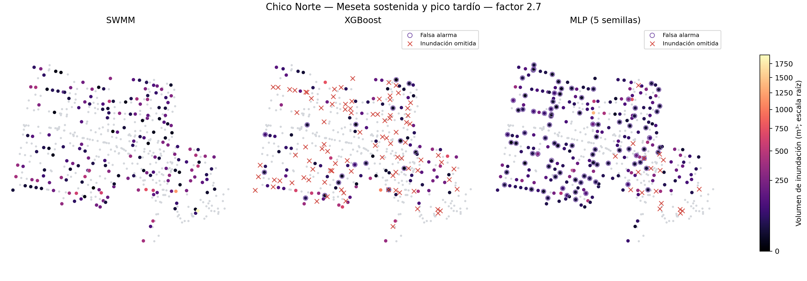

# Figuras de evaluación de hidrogramas nuevos en Chico Norte

Las cinco figuras corresponden al lote congelado de 10 escenarios, con SWMM como referencia. El análisis y los límites están en el [informe de evaluación](../superpowers/reports/2026-11-02-evaluacion-hidrogramas-nuevos-chico-norte.md). Los SHA-256 se registran en `evaluation_completion.json` dentro del paquete de [evidencia](../resultados/evidencia_evaluacion_chico_norte_2026_11_02/).

## Hidrogramas

## Paridad global

## Volumen total por factor

## Mapas de inundación para el factor 2,7

El factor 2,7 es la mediana del conjunto muestreado. Cada mapa tiene su propia escala de color; las intensidades de color entre mapas no deben compararse directamente.
